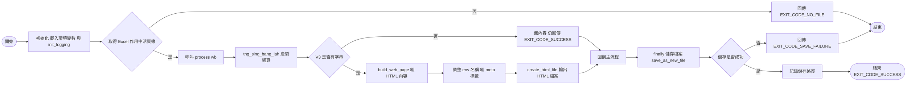
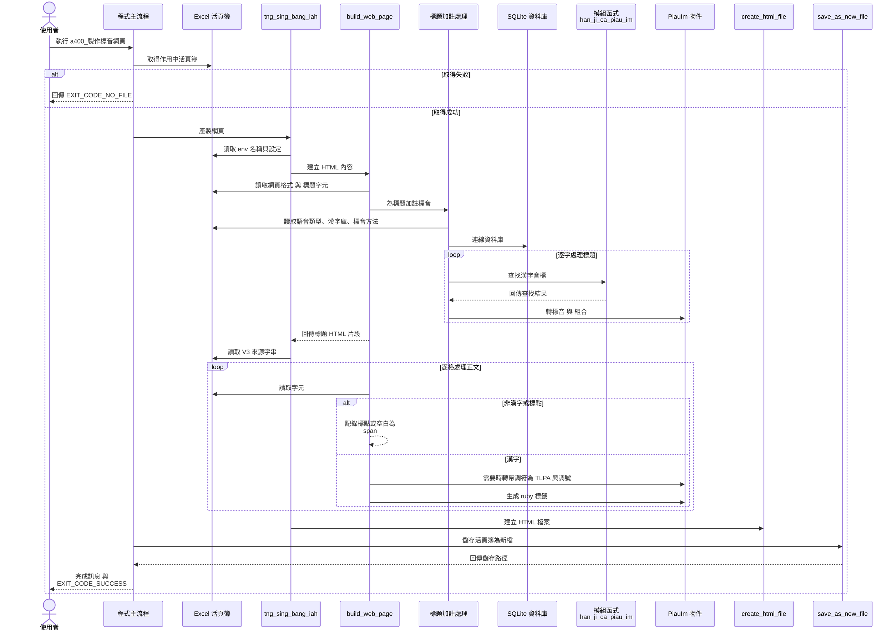

# a400 程式說明文件

依據【漢字注音】工作表之內容，製作成帶有漢字標音之網頁。


## 作業流程



## 循序圖



## 支援變調標音格式

依據【漢字注音】工作表，製作帶 `<ruby>` 的網頁時，以`【本調】`/`【變調】`樣式，製作 <rt> 中的【漢字標音】。

### 辭彙解釋

- 變調標音格式：`duan⁵⁻³`
- 本調標音格式：`duan⁵`

- 各種【漢字標音法】之標準/本調/變調標音格式對照表

| 漢字標音法 | 標準標音格式 | 本調標音格式 | 變調標音格式  |
|-------|--------|--------|---------|
| 十五音   | 地觀三    | 地觀三    | 地觀三-七   |
| 雅俗通   | 觀三地    | 地觀三    | 地觀三-七   |
| 方音符號  | ㄉㄨㄢ˪   | ㄉㄨㄢ³   | ㄉㄨㄢ³⁻⁷  |
| 台語音標  | tuan3  | tuan³  | tuan³⁻⁷ |
| 台羅拼音  | tuàn   | tuan³  | tuan³⁻⁷ |
| 白話字   | toàn   | toan³  | toan³⁻⁷ |
| 注音二式  | duan3  | duan³  | duan³⁻⁷ |
| 閩拼調號  | duan5  | duan⁵  | duan⁵⁻³ |
| 閩拼調符  | duàn   | duan⁵  | duan⁵⁻³ |


流程：

 1. 先完成**`【漢字注音】工作表`**

|     | D | E | F | G | H | I | J | K | L | M | N | O | P | Q | R |
|-----|---|---|---|---|---|---|---|---|---|---|---|---|---|---|---|
| 11  |   |   |   |   |   |   |   |   |   |   |   |   |   |   |   |
| 12 | tuan3 | hong5 | ze3 | u2  |   | zing7 | ciu1 | khong1 |   | san1 | liam2 | siu1 | bi5  | sin1 | liok8 |
| 13 | 斷     | 虹     | 霽   | 雨   | ， | 淨     | 秋    | 空      | ， | 山    | 染     | 修    | 眉    | 新    | 綠     |
| 14 | duàn | hóng | zè | wǔ |   | zîng | cīu | kōng  |   | sān | liǎm | sīu | bbí | sīn | liók |

 2. 將`【漢字注音】工作表`中的`【漢字儲存格】`，把`【底色】`改塗成`淺灰色`（#E8E8E8）。以此方式，指示此漢字的【漢字標音】，若`【使用變調標音格式】`被設定為`是`時，則 <rt> 中的【漢字標音】需採 `變調標音格式`；其餘未標示之儲存格則用`本調標音格式`。。

    如：`D13`、`F13`、`I13`、`J13`、`M13`、`O13`、`Q13`。

 3. 在`【env】工作表`，將`【使用變調標音格式】`儲存格，設定成`是`。

    此後可想像，執行 a400.py 程式後，在 `<rt>...</rt>` 之中的`【漢字標音】`內容：
    - 使用**變調標音格式**：`D14`、`F14`、`I14`、`J14`、`M14`、`O14`、`Q14`；
    - 使用**本調標音格式**：`E14`、`G14`、`K14`、`N14`、`P14`。

|     | D | E | F | G | H | I | J | K | L | M | N | O | P | Q | R |
|-----|---|---|---|---|---|---|---|---|---|---|---|---|---|---|---|
| 11  |   |   |   |   |   |   |   |   |   |   |   |   |   |   |   |
| 12 | tuan3 | hong5 | ze3 | u2  |   | zing7 | ciu1 | khong1 |   | san1 | liam2 | siu1 | bi5  | sin1 | liok8 |
| 13 | 斷     | 虹     | 霽   | 雨   | ， | 淨     | 秋    | 空      | ， | 山    | 染     | 修    | 眉    | 新    | 綠     |
| 14 |duan⁵⁻³|hong²|ze⁵⁻³|wu³|，|zing⁶⁻⁵|ciu¹⁻⁶|kong¹|，|san¹⁻⁶ |liam³|siu¹⁻⁶|bbi²|sin¹⁻⁶|liok⁸|

## 使用變調標音格式之程式處理邏輯

以下借用【虛擬碼】之概念，透過 PlantUML 之【流程圖腳本】進行程式之處理邏輯描述。

```plantuml
start
repeat
    :設定【漢字儲存格指標】;

    '製作 <ruby> 中的 <rt> 內容
    if (標音方式=上 or 標音方式=上及右) then (yes)
        if (使用變調標音格式) then (yes)
            if (漢字儲存格底色= '#E8E8E8') then (yes)
                :將 ruby tag 的 data-pian-tiau 屬性設定【true】;
                :將【台語音標】依【上邊標音】設定，轉換成【採用變調格式】的【漢字標音】;
                :依【變調格式的漢字標音】製成<rt>內容;
            else (no)
                :將 ruby tag 的 data-pian-tiau 屬性設定【false】;
                :將【台語音標】依【上邊標音】設定，轉換成【採用本調格式】的【漢字標音】;
                :依【本調格式的漢字標音】製成<rt>內容;
            endif
        else (<color:red>no)
            :延用原處理邏輯，製成<rt>內容;
        endif
    endif

    '製作 <ruby> 中的 <rtc> 內容
    if (標音方式=右 or 標音方式=上及右) then (yes)
        :製作 <rt> 內容;
    endif

    :依<rt>及<rtc>內容，製作<ruby>內容;

    ' 製作 <html> 內容
    :將<ruby>內容加入<html>內容;

    :將【漢字儲存格指標】往後移動一格;
repeat while (漢字儲存格尚未讀到【終止文章】？) is (<color:red>yes)
->no;
'程式終止前處理作業
:延用原處理邏輯;
stop
@enduml
```