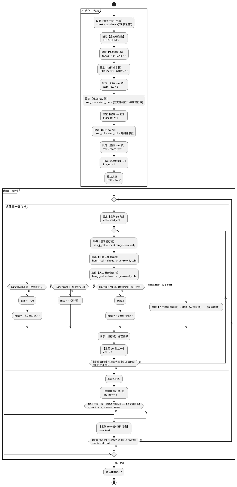

# PRG-c100_程式說明文件  v0.0.1

## 摘要

將【作用活頁簿檔案】（workbook）中之【漢字注音】工作表，其中各個【漢字標音】儲存格，更改成【標音變調格式】及【標音本調格式】。

**`【漢字注音】工作表改變調前`**

|     | D | E | F | G | H | I | J | K | L | M | N | O | P | Q | R |
|-----|---|---|---|---|---|---|---|---|---|---|---|---|---|---|---|
| 11  |   |   |   |   |   |   |   |   |   |   |   |   |   |   |   |
| 12 | tuan3 | hong5 | ze3 | u2  |   | zing7 | ciu1 | khong1 |   | san1 | liam2 | siu1 | bi5  | sin1 | liok8 |
| 13 | 斷     | 虹     | 霽   | 雨   | ， | 淨     | 秋    | 空      | ， | 山    | 染     | 修    | 眉    | 新    | 綠     |
| 14 | duàn | hóng | zè | wǔ |   | zîng | cīu | kōng  |   | sān | liǎm | sīu | bbí | sīn | liók |

【漢字注音】工作表，【漢字儲存格】：`D13`、`F13`、`I13`、`J13`、`M13`、`O13`、`Q13`，上述各儲存格的【底色】各被塗成`淺灰色`（#E8E8E8），指示此漢字的【漢字標音儲存格】應改成`變調標音格式`；其餘的儲存格則改成`本調標音格式`。

**`【漢字注音】工作表改變調後`**

|     | D | E | F | G | H | I | J | K | L | M | N | O | P | Q | R |
|-----|---|---|---|---|---|---|---|---|---|---|---|---|---|---|---|
| 11  |   |   |   |   |   |   |   |   |   |   |   |   |   |   |   |
| 12 | tuan3 | hong5 | ze3 | u2  |   | zing7 | ciu1 | khong1 |   | san1 | liam2 | siu1 | bi5  | sin1 | liok8 |
| 13 | 斷     | 虹     | 霽   | 雨   | ， | 淨     | 秋    | 空      | ， | 山    | 染     | 修    | 眉    | 新    | 綠     |
| 14 |duan⁵⁻³|hong²|ze⁵⁻³|wu³|，|zing⁶⁻⁵|ciu¹⁻⁶|kong¹|，|san¹⁻⁶ |liam³|siu¹⁻⁶|bbi²|sin¹⁻⁶|liok⁸|

- 使用`變調標音格式`的【漢字標音儲存格】：`D14`、`F14`、`I14`、`J14`、`M14`、`O14`、`Q14`；
- 使用`本調標音格式`的【漢字標音儲存格】：`E14`、`G14`、`K14`、`N14`、`P14`。

## 程式撰碼規範

1. 如何掃瞄整張【漢字注音】工作表，其**迴路邏輯**，請參考**程式**： `a400.py` 或 `a200.py`

2. 如何判斷【漢字標音儲存格】該使用何種`標音格式`？

```python
if 漢字儲存格底色（背景色）= '#E8E8E8':
	變更【漢字標音儲存格】之內容，改成【變調標音格式】
else:
	變更【漢字標音儲存格】之內容，改成【本調標音格式】
```

- 變調標音格式：`duan⁵⁻³`
- 本調標音格式：`duan⁵`

3. 各種【漢字標音法】之格式對照表

| 漢字標音法 | 標準標音格式 | 本調標音格式 | 變調標音格式  |
|-------|--------|--------|---------|
| 十五音   | 地觀三    | 地觀三    | 地觀三-七   |
| 雅俗通   | 觀三地    | 地觀三    | 地觀三-七   |
| 方音符號  | ㄉㄨㄢ˪   | ㄉㄨㄢ³   | ㄉㄨㄢ³⁻⁷  |
| 台語音標  | tuan3  | tuan³  | tuan³⁻⁷ |
| 台羅拼音  | tuàn   | tuan³  | tuan³⁻⁷ |
| 白話字   | toàn   | toan³  | toan³⁻⁷ |
| 注音二式  | duan3  | duan³  | duan³⁻⁷ |
| 閩拼調號  | duan5  | duan⁵  | duan⁵⁻³ |
| 閩拼調符  | duàn   | duan⁵  | duan⁵⁻³ |

## 【漢字注音】工作表處理邏輯

以下之 PlantUML 流程圖，說明：

- 讀完【漢字注音】工作表每個儲存格的【迴路】（loop）處理邏輯；
- 如何移動【漢字儲存格】指標；
- 如何透過【漢字儲存格】指標，取得 -2 列之【人工標音儲存格】；
- 如何透過【漢字儲存格】指標，取得 -1 列之【台語音標儲存格】；
- 如何透過【漢字儲存格】指標，取得 +1 列之【漢字標音儲存格】；
- 何時應【換行】，即：換到工作表的下一列（Row）；
- 何時可終止繼續讀取【漢字儲存格】之工作。



## 實作摘要

- 掃【漢字注音】工作表（迴路比照 a200／a201）
-【漢字】底色為 #E8E8E8 (232,232,232) → 變調（如 duan⁵⁻³）
- 其餘漢字 → 本調（如 hong²）
- 依 env【標音方法】輸出對應格式（閩拼／台語音標／台羅／白話字／方音／十五音等）
- 標點會同步寫入【漢字標音】列

## 使用方式

### 正式操作

```python
# 作用中活頁簿需已開啟
python c100_漢字標音儲存格改用變調標示格式.py
```

### 驗證測試

```python
# 單元測試（對照文件《念奴嬌》閩拼範例）
python c100_漢字標音儲存格改用變調標示格式.py --test
```

--test 已全部通過，含文件中的 duan⁵⁻³、zing⁶⁻⁵、ciu¹⁻⁶ 等。
